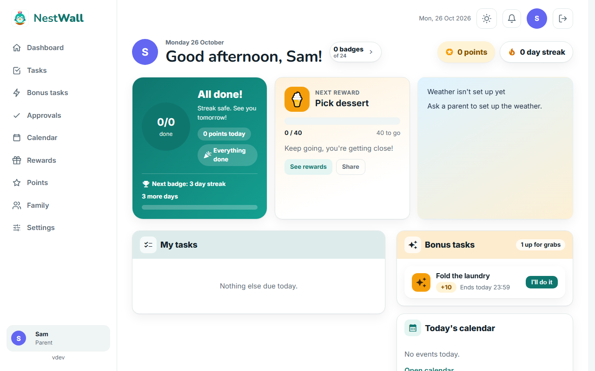
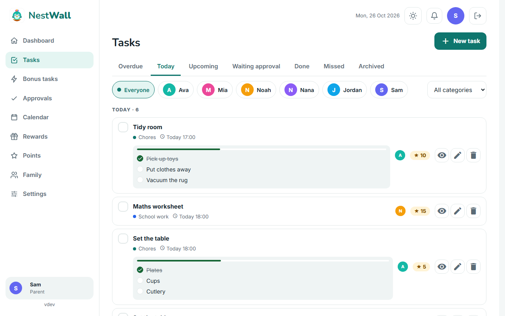
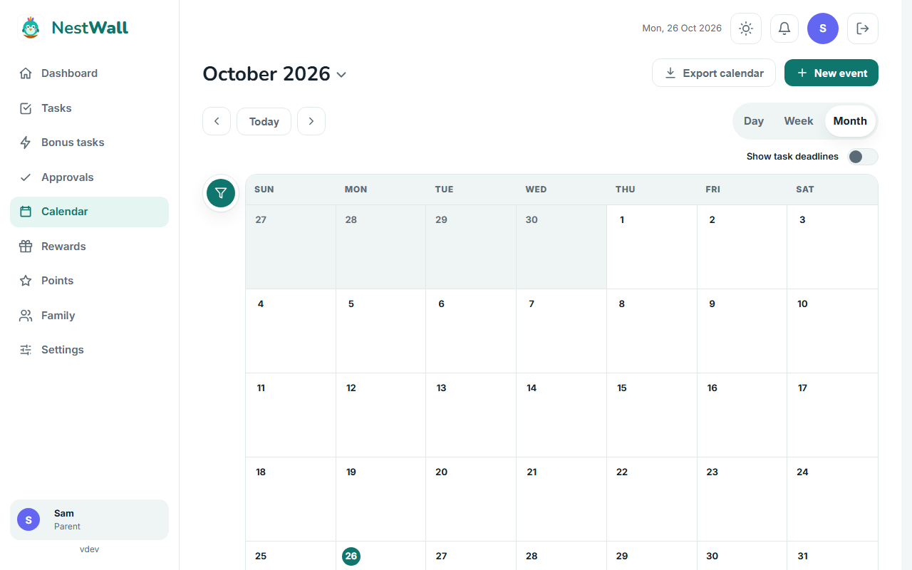
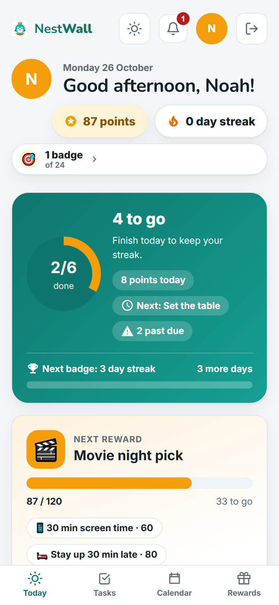
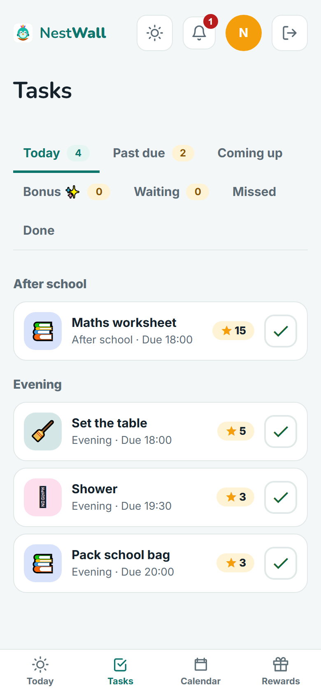
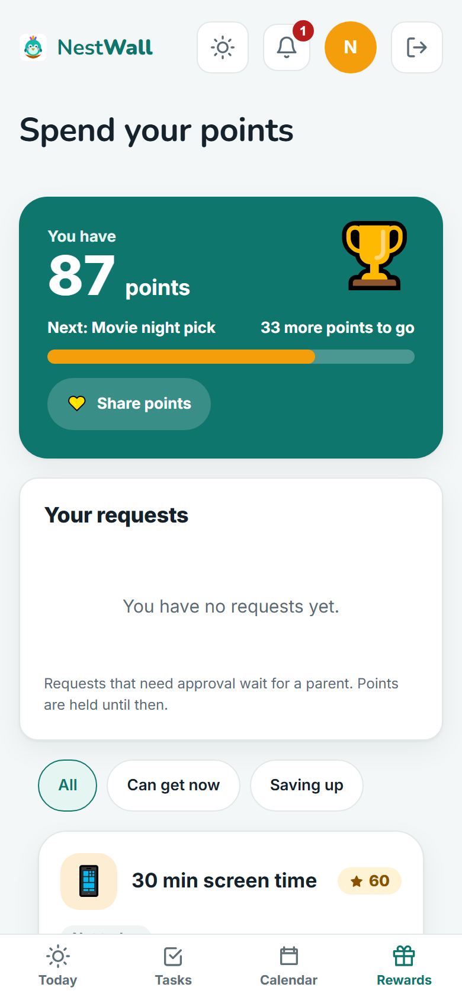
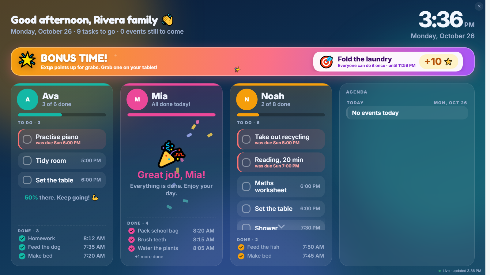

<p align="center">
  
</p>

<h1 align="center">NestWall</h1>

<p align="center">
  <strong>A self-hosted family planner for phones, tablets, a wall display and the web.</strong>
</p>

NestWall keeps the family's chores, tasks, rewards and calendar in one place that you host yourself.
Kids earn points and rewards, parents stay in control, and a wall display in the hallway shows what is due today.

## Screenshots

The screenshots use the demo Rivera family.

**Parents** (desktop)

<table>
<tr>
<th>Today</th>
<th>Tasks</th>
<th>Calendar</th>
</tr>
<tr>
<td></td>
<td></td>
<td></td>
</tr>
</table>

**Kids** (phone)

<table>
<tr>
<th>Today</th>
<th>Tasks</th>
<th>Rewards</th>
</tr>
<tr>
<td></td>
<td></td>
<td></td>
</tr>
</table>

**Wall display** (hallway TV)

<p align="center">
  
</p>

## ✨ Features

- **Chores and tasks**: recurring and one-off tasks, grouped by category and part of day, with optional steps.
- **Points and penalties**: points for approved tasks, with percentage or fixed penalties for missed ones.
- **Rewards and badges**: kids redeem points for rewards and earn automatic badges for milestones.
- **Bonus tasks**: open tasks that anyone in the family can claim.
- **Shared calendar**: local events plus ICS import, export and external calendar sources.
- **Wall mode**: a TV-friendly display with weather, automatic night dimming and a parents-only exit code.
- **Kid view**: a simplified screen with a Today tab, a progress ring and "I'm done!" buttons.
- **Installable web app**: works as a PWA on phones and tablets, with notifications.
- **Roles and permissions**: parents, children and custom child or co-parent roles, with per-person overrides and an audit log. Wall displays are paired devices, not a role.
- **Private by design**: one encrypted SQLite database on your own machine, no cloud account.
- **Backups and restore**: a restore command, a backup runbook, and a diagnostics page for parents.
- **Home Assistant**: integration guide in [home-assistant.md](docs/home-assistant.md).

## 🧰 Stack

| Layer | Technology |
|---|---|
| Frontend | Angular (standalone components, Signals) with Angular Material 3, PWA via `@angular/service-worker` |
| Backend | Go modular monolith (`net/http`, `database/sql`, SQLCipher) |
| Database | One encrypted SQLite file at `database/nestwall.db` (key in `DB_KEY`), openable with DB Browser for SQLite when the API is stopped |
| Deployment | Docker Compose: `frontend` (Nginx), `api` (Go, with SQLite inside) |

## Repository layout

```
nestwall/
├── frontend/            Angular app (src/app with core, shared, features; images and fonts in src/assets)
├── backend/             Go API (cmd/api, internal/<module>, database/migrations, openapi)
├── deploy/              deploy/compose.yaml (build from source)
├── compose.release.yaml install from the published images (non-developers)
├── docs/                install, backup, Home Assistant and release guides, final progress
├── scripts/             version bump script used by the release workflow
├── logs/                local log files (git-ignored)
│   ├── docs/            specification, progress and backlog
│   ├── mock/            UI mockups
│   └── tools/           generators for the spec, brand assets and mocks
└── .env.example         environment template (copy to deploy/.env, never commit it)
```

## Documentation

- `docs/install-guide.md` — install with Docker Compose from the published images (no coding needed; Windows, macOS, Linux and NAS)
- `docs/dev-guide.md` — build from source, first sign-in, wall displays, upgrade, rollback and troubleshooting
- `docs/backup-restore.md` — backup and restore runbook
- `docs/release-guide.md` — how to release a new version and roll it back

## Getting started

Requirements: Docker with the Compose plugin.

1. Create the configuration file from the template:
   ```bash
   cp .env.example deploy/.env
   ```
2. Open `deploy/.env` and set `DB_KEY` and `SESSION_SECRET` (see [Configuration](#configuration)). Generate the secret with `openssl rand -base64 48`.
3. Build and start the stack:
   ```bash
   docker compose -f deploy/compose.yaml up -d --build
   ```
4. Open `http://localhost:5842` and create the first account.

The full install steps are in [install-guide.md](docs/install-guide.md). Developers who build from source should use [dev-guide.md](docs/dev-guide.md).

### Configuration

Compose reads these values from a `.env` file next to the compose file it runs. [.env.example](.env.example) lists every variable with comments.

| Variable | Required | What it does |
|---|---|---|
| `DB_KEY` | Yes | Passphrase that encrypts the database. Without it the data cannot be opened. Keep a copy outside the repo. |
| `SESSION_SECRET` | Yes | Secret that signs sign-in sessions. Use at least 48 random characters. |
| `APP_URL` | No | Address of the app, including the port. Used in password reset emails. Default `http://localhost:5842`. |
| `WEB_PORT` | No | Port on the host that opens NestWall. Default `5842`. Keep `APP_URL` on the same port. |
| `TZ` | No | Time zone for scheduled backups. Default `America/Toronto`. |
| `NESTWALL_VERSION` | No | Image version for `compose.release.yaml`. Default `latest`. Pin a version such as `1.0.0` to control upgrades. |

Never commit `.env`. It is git-ignored because it holds your keys.

### Install with Docker Compose (no coding needed)

Families who only want to run NestWall can skip the source code. Download [compose.release.yaml](compose.release.yaml) and [.env.example](.env.example) into one folder, rename the copy to `.env`, set `DB_KEY` and `SESSION_SECRET`, and start it with `docker compose -f compose.release.yaml up -d`. The step-by-step guide, which works on Windows, macOS, Linux and NAS boxes, is in [install-guide.md](docs/install-guide.md).

### Android app

Download the latest signed APK from the [NestWall Android releases](https://github.com/alisohail/nestwall/releases?q=NestWall+Android). Each Android release is titled `NestWall Android <version>` and attaches `official-nestwall-<version>.apk`. Open it on your phone and allow installs from your browser when Android asks. The app connects to your own NestWall server, so run the server first.

[](https://github.com/alisohail/nestwall/releases?q=NestWall+Android)

## Releases

Versions follow semantic versioning and are read from [VERSION](VERSION).

- Every push to `main` bumps the version from the commits since the last `v*` tag. `feat` bumps the minor version, `feat!` or a `BREAKING CHANGE:` footer bumps the major version, and anything else bumps the patch version. The bump is committed back to `main`, tagged `v<version>`, and published.
- Pushing a `v*.*.*` tag publishes that tag.
- Publishing builds `linux/amd64` images and pushes them to GitHub Container Registry as `ghcr.io/alisohail/nestwall-api` and `ghcr.io/alisohail/nestwall-web`. Each image gets the tags `X.Y.Z`, `X.Y` and `latest`. A GitHub Release is created for the tag.
- The Android app has its own version in [mobile/android/VERSION](mobile/android/VERSION). It bumps only when commits touch `mobile/android/`, and each bump publishes a GitHub Release tagged `android-v<version>` with the signed APK attached.
- The workflows are in [.github/workflows/](.github/workflows/) and [scripts/bump-version.sh](scripts/bump-version.sh) and [scripts/bump-android-version.sh](scripts/bump-android-version.sh).
- For the steps to release and roll back, see [release-guide.md](docs/release-guide.md).

